

  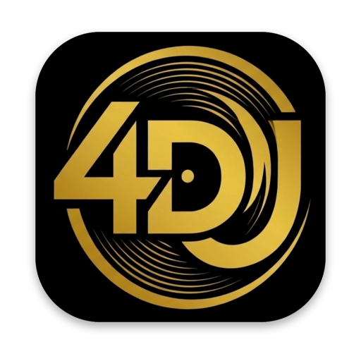

<h1 align="center">4DJ</h1>

  Software per DJ per macOS, Windows e Linux (Android in arrivo) 
  <a href="README.md">English</a> · <b>Italiano</b> · <a href="https://github.com/kikoz85/4dj/releases/latest"><b>Scarica</b></a>

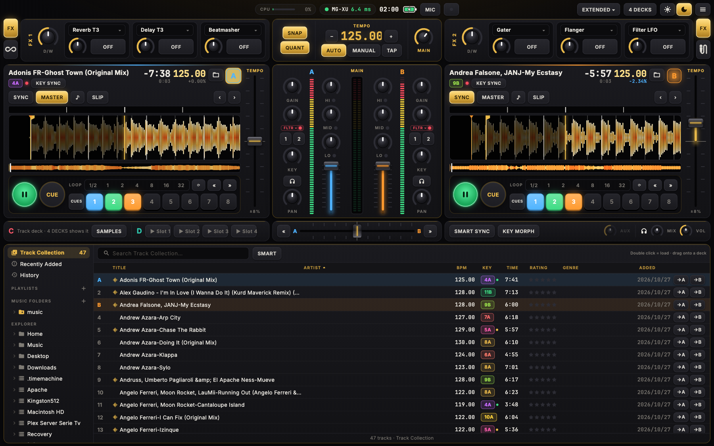

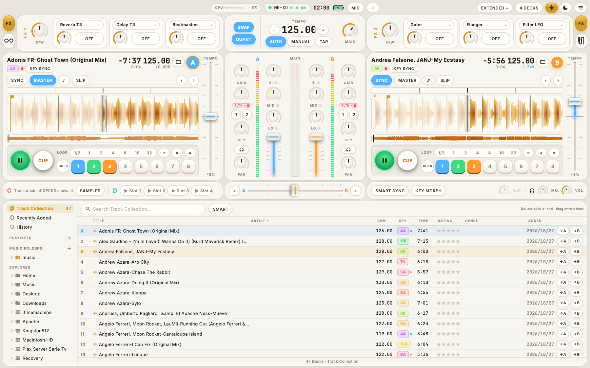

4DJ ha la disposizione che i DJ conoscono già: deck, mixer, effetti e browser dove te li aspetti, così puoi mixare subito. E va oltre: stem creati sul tuo computer, transizioni che restano in tonalità e a tempo, un tablet come secondo schermo e controller che si mappano da soli.

## Indice

- [Scarica e installa](#scarica-e-installa)
- [Requisiti di sistema](#requisiti-di-sistema)
- [Cosa fa 4DJ](#cosa-fa-4dj)
- [Screenshot](#screenshot)
- [Kontrol S2 MK3](#kontrol-s2-mk3)
- [Tastiera](#tastiera)
- [Aggiornamenti](#aggiornamenti)
- [Domande](#domande)

## Scarica e installa

Scarica l'installer per il tuo sistema dall'[ultima release](https://github.com/kikoz85/4dj/releases/latest).

| Sistema | File | Installazione |
|---|---|---|
| macOS 13.4 o successivo (Apple Silicon e Intel) | `4DJ-<versione>-macOS.dmg` | Apri il DMG e trascina 4DJ in Applicazioni. La prima volta macOS può dire che non riesce a verificare l'app: apri **Impostazioni di Sistema → Privacy e sicurezza** e scegli **Apri comunque**. |
| Windows 10/11, x64 o ARM64 | `4DJ-<versione>-windows-x64.msi` o `-arm64.msi` | Avvia l'MSI. Se SmartScreen lo blocca, scegli **Ulteriori informazioni → Esegui comunque**. |
| Linux x64 o ARM64: Debian, Ubuntu, Mint… | `4dj_<versione>_amd64.deb` o `_arm64.deb` | Aprilo con il programma di installazione, oppure `sudo apt install ./4dj_<versione>_amd64.deb` (`_arm64.deb` su ARM). |
| Linux x64 o ARM64: Fedora, openSUSE… | `4dj-<versione>-1.x86_64.rpm` o `.aarch64.rpm` | Aprilo con il programma di installazione, oppure `sudo dnf install ./4dj-<versione>-1.x86_64.rpm` (`.aarch64.rpm` su ARM). |
| Linux x64 o ARM64: qualsiasi distribuzione | `4DJ-<versione>-linux-x86_64.AppImage` o `-aarch64.AppImage` | Rendilo eseguibile (Proprietà → Consenti l'esecuzione) e aprilo. |

Al primo avvio il **Setup Assistant** chiede tre cose: la scheda audio, le cartelle della tua musica e quanti deck vuoi. Vieni da un'altra app per DJ? **Import collection (.nml)** nel browser porta le tue tracce con BPM, tonalità, beatgrid, hotcue, valutazioni e playlist. Il file della collezione viene solo letto, mai modificato.

## Requisiti di sistema

| | Minimi | Consigliati |
|---|---|---|
| **macOS** | macOS 13.4, Intel o Apple Silicon, 8 GB di RAM | Apple Silicon (M1 o successivo), 16 GB di RAM |
| **Windows** | Windows 10 a 64 bit (x64 o ARM64), CPU dual-core, 8 GB di RAM | Windows 11, CPU quad-core (Intel Core i5 di 8ª generazione / Ryzen 5 o superiore), 16 GB di RAM |
| **Linux** | 64 bit (x64 o ARM64) con glibc 2.35: Ubuntu 22.04, Debian 12, Fedora 36 o successivi; GTK 3, PipeWire o ALSA; CPU quad-core, 8 GB di RAM | Ubuntu 24.04, Debian 13, Fedora 39 o successivi (necessari per StemX); PipeWire; 16 GB di RAM |

Per tutti i sistemi:

- **Disco:** circa 1 GB per 4DJ e il modello StemX, più circa 13 MB per ogni minuto di musica separata in stem. Un SSD carica le tracce più in fretta.
- **Audio:** va bene qualsiasi scheda audio. Per ascoltare in cuffia la traccia successiva serve una scheda con 4 uscite o un controller DJ con scheda audio integrata (come la Kontrol S2 MK3).
- **Schermo:** 1280 × 800 o più grande.
- **StemX** lavora sul processore ed è il compito più pesante: su un PC a basso consumo (come un Intel N95) una traccia richiede qualche minuto; puoi preparare gli stem in anticipo dal browser.

## Cosa fa 4DJ

### Deck
- 2 o 4 deck. Play, CUE (tenuto: anteprima, come un CDJ), 8 hotcue per traccia, loop da 1/2 a 32 battute, beatjump, Slip mode e reverse.
- Tempo fader con key lock, manopola KEY per ±12 semitoni, e SYNC (Beat Sync o Tempo Sync).
- Scratch e nudge trascinando la waveform. Waveform a colori con zoom, overview, segni di cue e loop, e avviso prima della fine della traccia.
- Un **phase meter** sopra ogni waveform mostra quanto le battute sono lontane da quelle dell'altro deck: mixando a mano, tieni la barra al centro (diventa verde quando sono a tempo).

### StemX: stem sul tuo computer
- Divide qualsiasi traccia in **batteria, basso, altro e voce**, senza mandare nulla online.
- Seleziona le tracce nel browser e scegli **Prepare Stems**. Ogni traccia si fa una volta sola; mentre un deck suona il lavoro aspetta, così il set non rallenta mai.
- Sul deck ogni stem ha volume, mute, filtro e il suo interruttore FX. **ACAP** lascia solo la voce, **INST** la toglie.

### SmartSync e Key Morphing
- **SMART SYNC** rende il prossimo crossfade armonico e a tempo: tonalità e tempo scorrono insieme e la traccia nuova finisce nella sua tonalità e nel suo tempo.
- **SMART** nel browser ordina le tracce per quanto si mixano bene con quella in play.

### Mixer ed effetti
- EQ a tre bande e filtro in stile club. Crossfader con curva, auto crossfade, cue mix in cuffia.
- **Secondo dispositivo**: il master (o le cuffie) può suonare anche su un altro dispositivo audio, ad esempio il master su una cassa Bluetooth mentre le cuffie restano sulla console (Impostazioni → Audio → Output Routing).
- Due unità FX con 19 effetti (delay, riverberi, flanger, phaser, gater, beatmasher e altri), Insert o Post Fader.
- Mixer FX: la manopola del filtro può diventare un effetto. Il **Maximizer** alza il volume del master senza distorcere.

### Libreria e browser
- Track Collection, playlist, History, cartelle di musica e un **Explorer** per tutte le cartelle e i dischi del computer.
- Ricerca istantanea, ordinamento, valutazioni, selezione multipla, tonalità in Camelot, Open Key o notazione musicale, colorate in base a quanto si mixano.
- I tuoi file audio non vengono mai modificati.

### Registrazione, microfono e loop
- **Audio Recorder** con gain, meter e CUT, in WAV a 24 bit. Registra il master o un ingresso esterno.
- **Microfono** con talkover (la musica si abbassa mentre parli) e ingresso **Aux**.
- **Loop Recorder**: registra da 4 a 32 battute del master, del cue, del microfono o dell'aux, poi overdub, undo e redo.

### Ingressi, timecode e sync
- Deck **Live Input**: un giradischi o un CDJ attraverso EQ, filtro, FX e fader di un deck.
- **Timecode**: vinili o CD di controllo (portante a 2 kHz o 1 kHz) muovono la traccia (modalità relativa).
- **MIDI clock** in uscita verso drum machine e altri strumenti, o in ingresso per seguirli.

### Controller e tablet
- La **Kontrol S2 MK3** funziona in modo nativo: vedi sotto.
- I controller MIDI conosciuti si mappano da soli; tutti gli altri con il MIDI learn, oppure tenendo premuto un tasto e toccando il controllo sullo schermo.
- **RemoteDeck**: un tablet o un telefono sulla stessa rete diventa un secondo schermo e una superficie touch (waveform, hotcue, loop, XY pad per gli effetti).

### Aspetto e impostazioni
- **Day e Night**: due aspetti, scelti con il sole e la luna in alto a destra. Night è nero e oro per le consolle al buio, Day è chiaro per la luce del giorno e i set all'aperto.
- Sui portatili la barra in alto mostra la **batteria**, così durante un set senza corrente sai sempre quanta ne resta.
- I knob mostrano il valore in percentuale mentre si muovono.
- Una schermata di caricamento mostra la versione e ogni parte di 4DJ mentre si carica.
- **Android** (in arrivo): layout per telefono e tablet per fare un set intero dal dispositivo, con la Kontrol S2 MK3 via USB.
- Impostazioni complete, con **Export / Import** di tutte le impostazioni e **Reset to Defaults**.

## Screenshot

| | |
|---|---|
| 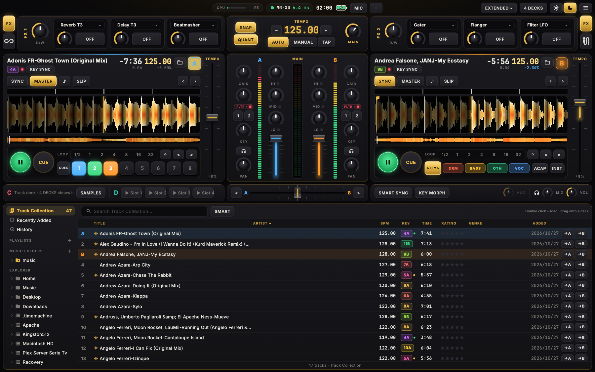 | 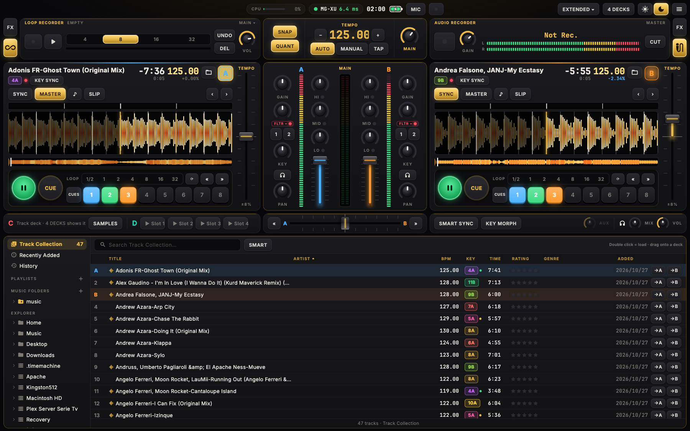 |
| **StemX**: il deck B come batteria, basso, altro e voce. | **Loop Recorder** e **Audio Recorder** negli spazi FX, si cambiano con le loro tab. |
| 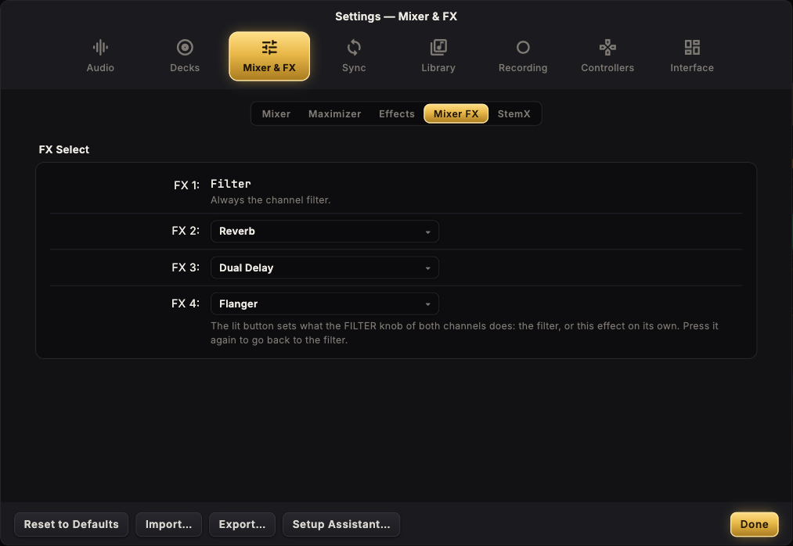 | 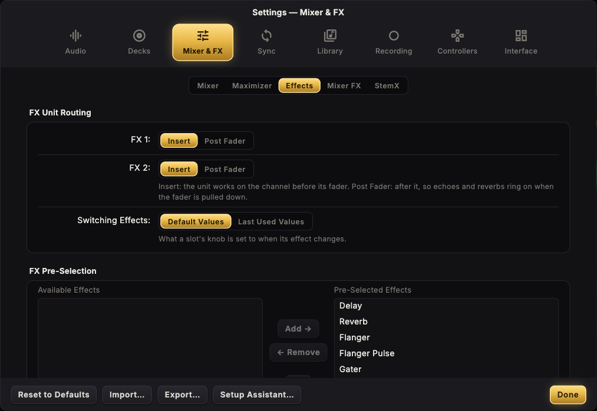 |
| **Mixer FX**: gli effetti dei tasti FX SELECT della S2 MK3. | **Effects**: routing e gli effetti offerti nei menu. |
| 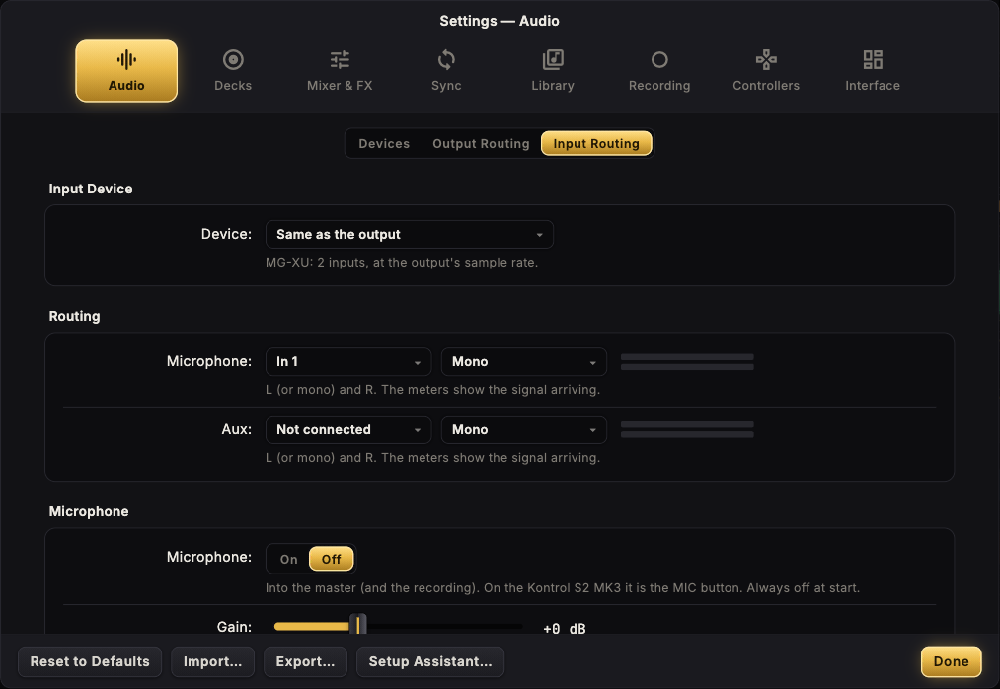 | 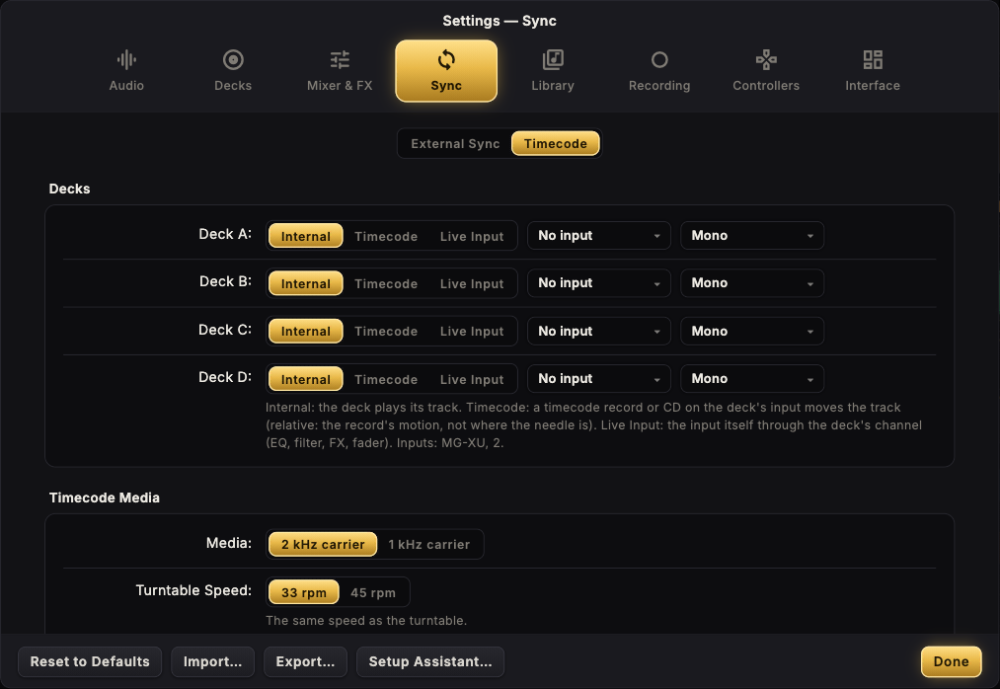 |
| **Input Routing**: microfono e aux con i meter, talkover. | **Timecode**: ogni deck suona la sua traccia, un vinile timecode o il suo ingresso. |
| 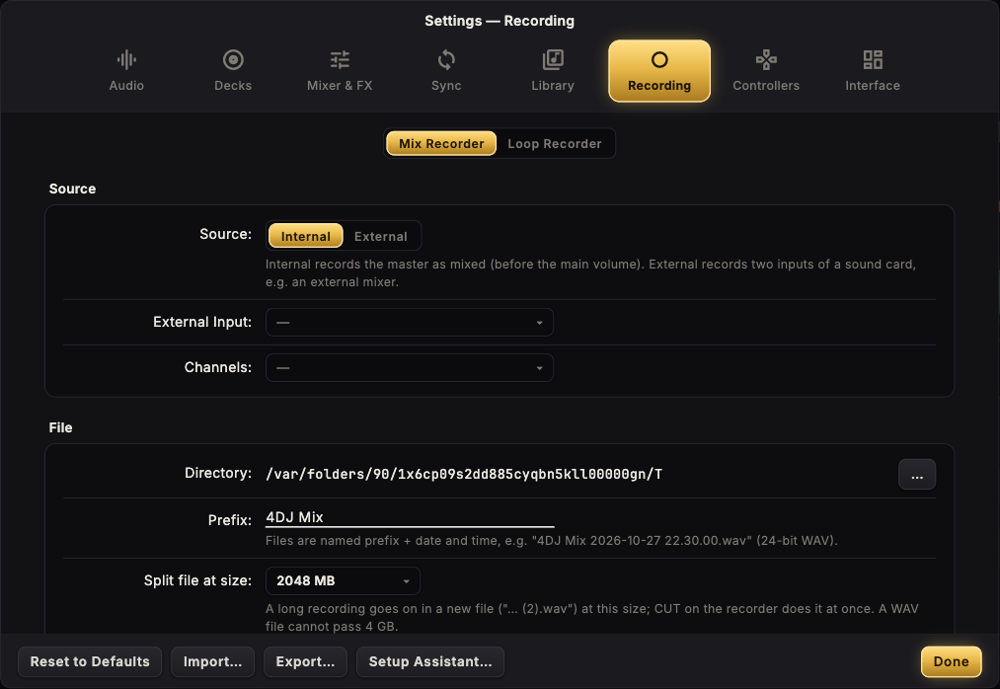 | 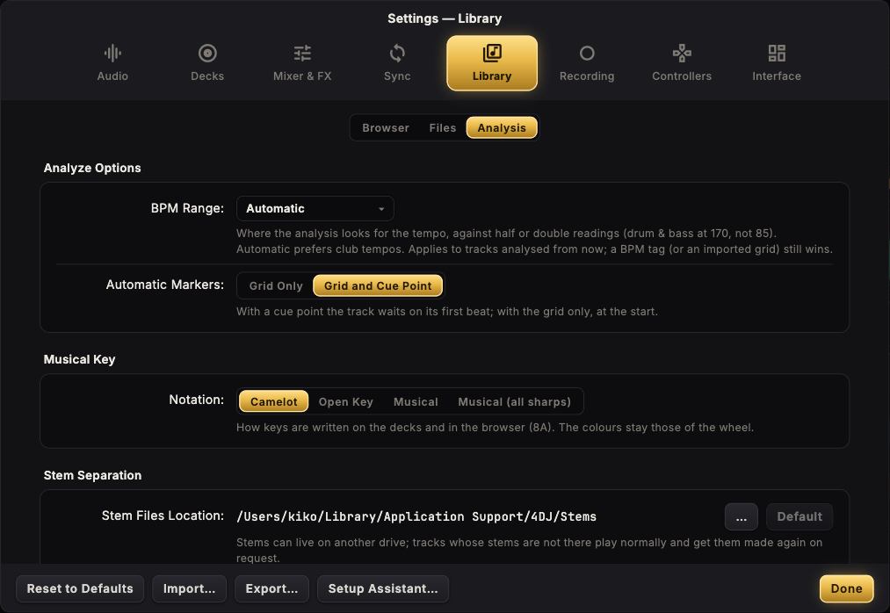 |
| **Mix Recorder**: sorgente, cartella, nome dei file, dimensione. | **Analysis**: range dei BPM, cue automatico, notazione delle tonalità, cartella degli stem. |
| 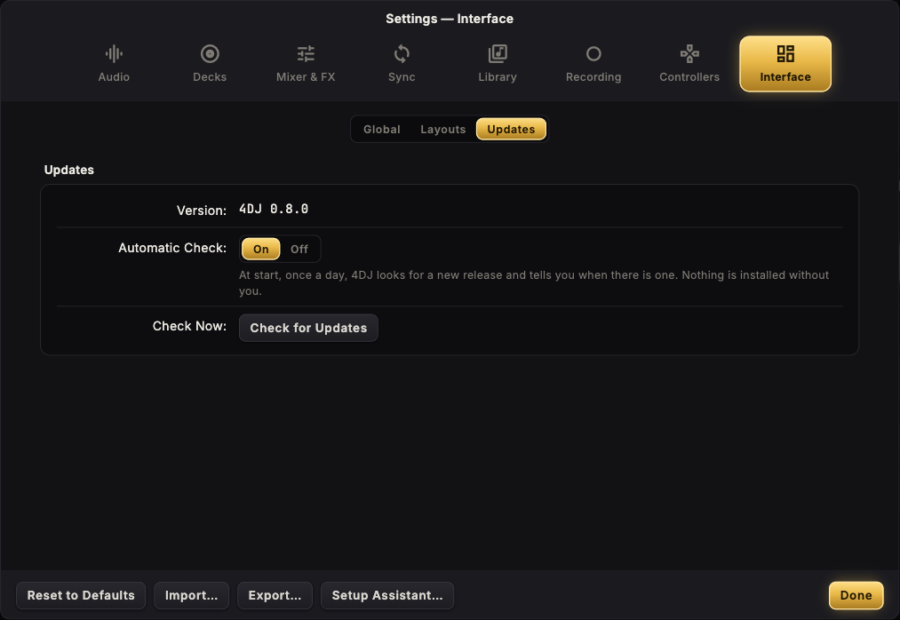 | |
| **Updates**: controllo automatico e Check for Updates. | |

## Kontrol S2 MK3

Collegala e 4DJ la usa subito, scheda audio compresa (master e cuffie), su macOS, Windows e Linux. 4DJ parte da come è impostata la console: fader, EQ, gain, filtro, crossfader e volume vengono letti quando si collega, così un fader abbassato o i bassi al massimo lasciati sulla console si ritrovano uguali sullo schermo. Quando chiudi 4DJ, le luci della console si spengono. Su Windows e Linux 4DJ usa la sua scheda in modalità a bassa latenza: circa 7 ms su Windows, circa 8 ms su Linux (16 ms dove il sistema non dà la priorità real-time all'audio, così non ci sono interruzioni).

Su Linux il .deb e l'.rpm danno a 4DJ l'accesso alla console già durante l'installazione: non c'è altro da fare. Con l'AppImage, la prima volta che colleghi la console 4DJ chiede di abilitarla: scegli **Enable** e inserisci la password una volta.

| Controllo | In 4DJ |
|---|---|
| PLAY, CUE, SYNC, KEYLOCK | Come scritto sulla console (SHIFT + CUE: torna all'inizio; SHIFT + SYNC: master; SHIFT + KEYLOCK: range del tempo) |
| FLX, REV | Slip mode; reverse finché tenuto |
| Jog | Sopra: scratch. Bordo: nudge. SHIFT: ricerca veloce |
| Pad | HOTCUES, SHIFT + HOTCUES = loop, SAMPLES = Sample Deck, SHIFT + SAMPLES = stem |
| BROWSE | Gira per scegliere, premi per caricare |
| MOVE | Beatjump |
| LOOP | Gira: ridimensiona il loop attivo o sceglie la misura del prossimo. Premi: loop acceso/spento |
| FX SELECT 1–4 | FX 1: filtro acceso/spento. FX 2–4: l'effetto scelto in Impostazioni → Mixer FX |
| MIC | Microfono acceso/spento, con talkover |
| QUANT | Quantizzazione |
| Mixer | Gain, EQ, filtro, fader, crossfader, cuffie, VU meter |

## Tastiera

| Tasti (deck A / deck B) | Funzione |
|---|---|
| Q / P | CUE (tenuto: anteprima) |
| W / O | Play / pausa |
| E / I | SYNC |
| 1 2 3 4 / 7 8 9 0 | Hotcue 1–4 |
| D / J | Loop acceso / spento |
| ← → | Crossfader |
| ↑ ↓ | Traccia precedente / successiva nel browser |
| Shift ← / Shift → | Carica la traccia selezionata sul deck A / B |
| ⌘F | Cerca |
| ⌘1 – ⌘4 | Layout: Essential, Mixer, Extended, Browser |

Su Windows e Linux ⌘ è Ctrl. In 4DJ premi **?** per l'elenco completo.

## Aggiornamenti

4DJ cerca una nuova release una volta al giorno all'avvio e te lo dice quando ce n'è una. In **Impostazioni → Interface → Updates** puoi spegnere il controllo automatico, oppure usare **Check for Updates** quando vuoi. **Download and Install** scarica l'installer per il tuo sistema e lo apre: non viene installato nulla senza di te.

## Domande

**Dove sono le mie impostazioni?** In 4DJ. **Impostazioni → Export…** le salva in un file, per un backup o un altro computer; **Import…** le riporta.

**4DJ modifica i miei file musicali?** No. BPM, tonalità, griglie, cue e valutazioni restano nella libreria di 4DJ.

**Su Windows, perché le altre app non suonano sulla scheda della console?** Per la latenza più bassa 4DJ prende la scheda della Kontrol S2 MK3 tutta per sé (modalità esclusiva). Le altre app tornano a suonare quando chiudi 4DJ; in **Impostazioni → Audio → Devices** puoi spegnere la modalità esclusiva (latenza più alta).

**Dove sono le mie registrazioni?** In Musica/4DJ Recordings, o nella cartella scelta in **Impostazioni → Recording → Mix Recorder**.

**Posso portare la collezione da un'altra app per DJ?** Sì, da un file collection.nml: **Import collection (.nml)** nel browser. Il file viene solo letto, mai modificato.

---

Copyright © 2026 Enrico Fanucchi. Tutti i diritti riservati. Componenti di terze parti: [THIRD_PARTY_NOTICES.md](THIRD_PARTY_NOTICES.md).

Kontrol S2 MK3 è un prodotto di Native Instruments GmbH; gli altri nomi sono marchi dei rispettivi proprietari. 4DJ è un software indipendente, non affiliato né approvato da loro.
