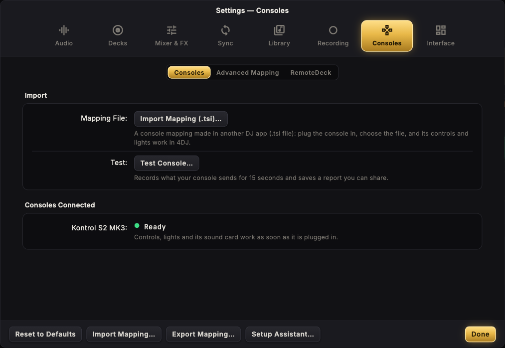
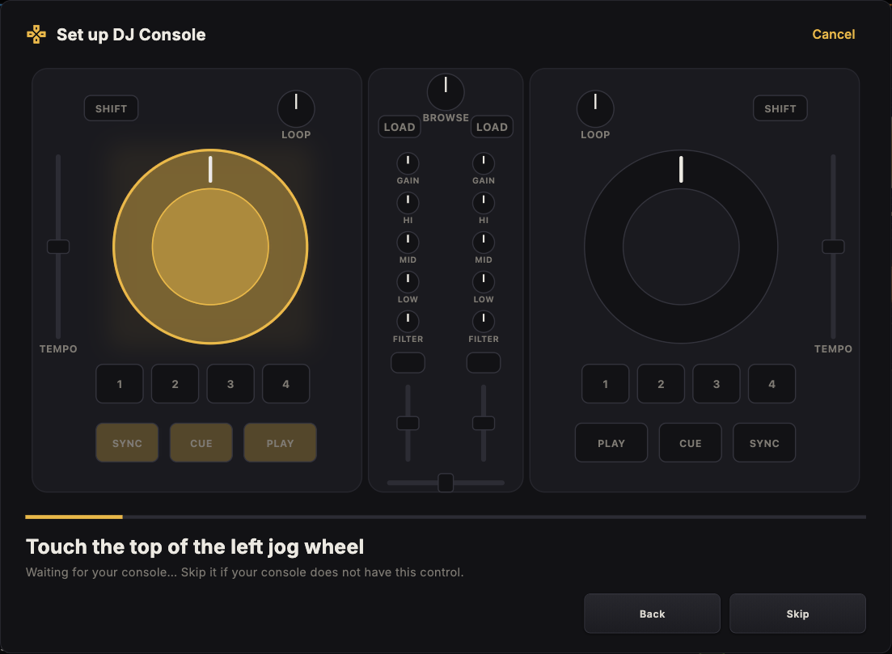

  

<h1 align="center">4DJ</h1>

  DJ software for macOS, Windows and Linux (Android coming) 
  <b>English</b> · <a href="README.it.md">Italiano</a> · <a href="https://github.com/kikoz85/4dj/releases/latest"><b>Download</b></a>

  
  

4DJ has the layout DJs already know: decks, mixer, effects and browser where you expect them, so you can start mixing right away. And it goes further: stems made on your own computer, transitions that stay in key and in tempo, a tablet as a second screen, and controllers that map themselves.

## Contents

- [Download and install](#download-and-install)
- [System requirements](#system-requirements)
- [What 4DJ does](#what-4dj-does)
- [Screenshots](#screenshots)
- [Kontrol S2 MK3](#kontrol-s2-mk3)
- [Keyboard](#keyboard)
- [Updates](#updates)
- [Support 4DJ](#support-4dj)
- [Questions](#questions)

## Download and install

Download the installer for your system from the [latest release](https://github.com/kikoz85/4dj/releases/latest).

| System | File | Install |
|---|---|---|
| macOS 13.4 or later (Apple Silicon and Intel) | `4DJ-<version>-macOS.dmg` | Open the DMG and drag 4DJ to Applications. The first time, macOS may say it cannot check the app: open **System Settings → Privacy & Security** and choose **Open Anyway**. |
| Windows 10/11, x64 or ARM64 | `4DJ-<version>-windows-x64.msi` or `-arm64.msi` | Run the MSI. If SmartScreen stops it, choose **More info → Run anyway**. |
| Linux x64 or ARM64: Debian, Ubuntu, Mint… | `4dj_<version>_amd64.deb` or `_arm64.deb` | Open it with your software installer, or `sudo apt install ./4dj_<version>_amd64.deb` (`_arm64.deb` on ARM). |
| Linux x64 or ARM64: Fedora, openSUSE… | `4dj-<version>-1.x86_64.rpm` or `.aarch64.rpm` | Open it with your software installer, or `sudo dnf install ./4dj-<version>-1.x86_64.rpm` (`.aarch64.rpm` on ARM). |
| Linux x64 or ARM64: any distribution | `4DJ-<version>-linux-x86_64.AppImage` or `-aarch64.AppImage` | Make it executable (Properties → Allow executing) and open it. |

On first start the **Setup Assistant** asks for three things: the sound card, your music folders and how many decks you want. Coming from another DJ app? **Import collection (.nml)** in the browser brings in your tracks with their BPM, keys, beatgrids, hotcues, ratings and playlists. The collection file is only read, never changed.

## System requirements

| | Minimum | Recommended |
|---|---|---|
| **macOS** | macOS 13.4, Intel or Apple Silicon, 8 GB RAM | Apple Silicon (M1 or later), 16 GB RAM |
| **Windows** | Windows 10 64-bit (x64 or ARM64), dual-core CPU, 8 GB RAM | Windows 11, quad-core CPU (Intel Core i5 8th gen / Ryzen 5 or better), 16 GB RAM |
| **Linux** | 64-bit (x64 or ARM64) with glibc 2.35: Ubuntu 22.04, Debian 12, Fedora 36 or later; GTK 3, PipeWire or ALSA; quad-core CPU, 8 GB RAM | Ubuntu 24.04, Debian 13, Fedora 39 or later (needed for StemX); PipeWire; 16 GB RAM |

For every system:

- **Disk:** about 1 GB for 4DJ and the StemX model, plus about 13 MB for each minute of music you separate into stems. An SSD loads tracks faster.
- **Sound:** any sound card works. To hear the next track in headphones you need a card with 4 outputs or a DJ controller with its own sound card (such as the Kontrol S2 MK3).
- **Screen:** 1280 × 800 or larger.
- **StemX** runs on the processor and is the heaviest task: on a low-power PC (such as an Intel N95) a track takes a few minutes; you can prepare stems in advance from the browser.

## What 4DJ does

### Decks
- 2 or 4 decks. Play, CUE (hold to preview, like a CDJ), 8 hotcues per track, loops from 1/2 to 32 beats, beatjump, Slip mode and reverse.
- Tempo fader with key lock, a KEY knob for ±12 semitones, and SYNC (Beat Sync or Tempo Sync).
- Scratch and nudge by dragging the waveform. Colour waveforms with zoom, overview, cue and loop markers, and a warning before the end of the track.
- A **phase meter** over each waveform shows how far the beats are from the other deck's: mixing by hand, keep the bar in the middle (it turns green when they are in time).

### StemX: stems on your computer
- Splits any track into **drums, bass, other and vocals**, without sending anything online.
- Select tracks in the browser and choose **Prepare Stems**. Each track is done once; while a deck plays, the work waits, so your set never slows down.
- On the deck, each stem has a volume, a mute, a filter and its own FX switch. **ACAP** keeps only the vocals, **INST** removes them.

### SmartSync and Key Morphing
- **SMART SYNC** makes the next crossfade harmonic and in tempo: the keys and tempos glide together and the new track ends up in its own key and tempo.
- **SMART** in the browser sorts the tracks by how well they mix with the one playing.

### Mixer and effects
- A club-style three-band EQ and filter. Crossfader with curve, auto crossfade, headphone cue mix.
- **Second device**: the master (or the headphones) can play on another sound device at the same time, e.g. the master on a Bluetooth speaker while the headphones stay on the console (Settings → Audio → Output Routing).
- Two FX units with 19 effects (delays, reverbs, flanger, phaser, gater, beatmasher and more), Insert or Post Fader.
- Mixer FX: the filter knob can be an effect. A **Maximizer** makes the master louder without clipping.

### Library and browser
- Track Collection, playlists, History, music folders and an **Explorer** for every folder and drive of your computer.
- Instant search, sorting, ratings, multiple selection, keys in Camelot, Open Key or musical notation, coloured by how they mix.
- Your audio files are never modified.

### Recording, microphone and loops
- **Audio Recorder** with gain, level meter and CUT, to 24-bit WAV. Records the master or an external input.
- **Microphone** with talkover (the music goes down while you talk) and an **Aux** input.
- **Loop Recorder**: record 4 to 32 beats of the master, the cue, the microphone or aux, then overdub, undo and redo.

### Inputs, timecode and sync
- **Live Input** decks: a turntable or a CDJ through a deck's EQ, filter, FX and fader.
- **Timecode**: control vinyl or CDs (2 kHz or 1 kHz carrier) move the track (relative mode).
- **MIDI clock** out to drum machines and other gear, or in to follow them.

### Consoles and tablet
- The **Kontrol S2 MK3** works natively: see below. The **Kontrol S2 MK1, S2 MK2, S3, S4 MK2 and S4 MK3** work natively too, in Beta: a two-minute check in **Settings → Consoles** confirms every control and light on your console, and corrects what differs.
- **Pioneer DJ** controllers are ready as soon as they are plugged in: DDJ-FLX4, DDJ-400, DDJ-FLX6, DDJ-1000, DDJ-800, DDJ-GRV6, DDJ-REV1, DDJ-REV5, DDJ-REV7 and DDJ-200 (from Pioneer DJ's published MIDI messages).
- **Any other console** is set up with a guided assistant: a drawing shows the control to touch, you touch it on the console; the right deck is found from the left one, then the lights. Nothing to type.
- **Import Mapping (.tsi)**: a console mapping made in another DJ app works in 4DJ, controls and lights.
- **Test Console** records what a console sends and saves a report you can share if something does not work. Fine-tuning by hand stays in **Advanced Mapping**.
- **RemoteDeck**: a tablet or phone on the same network becomes a second screen and a touch surface (waveforms, hotcues, loops, XY pad for effects).

### Look and settings
- **Day and Night**: two looks, switched with the sun and the moon at the top right. Night is black and gold for dark booths, Day is light for daylight and outdoor sets.
- On a laptop the top bar shows the **battery**, so you always know how much is left during a set without mains power.
- Knobs show their value in percent while they move.
- A loading screen shows the version and each part of 4DJ as it loads.
- **Android** (coming): phone and tablet layouts for a whole set from the device, with the Kontrol S2 MK3 over USB.
- **Five languages**: English, Italiano, Français, Deutsch and Español. 4DJ starts in your system's language (English when it is another one) and you can change it in **Settings → Interface → Global**. The words DJs use everywhere (PLAY, CUE, SYNC, LOOP, FX…) stay the same in every language.
- **Help** inside 4DJ (the **?** at the top right): every function explained, with search, in your language.
- **A broken file never stops your set**: a damaged or non-audio file is refused, the deck flashes red with **CANNOT LOAD** and the file's name, and the music goes on.
- Complete settings, with **Export / Import** of all settings and **Reset to Defaults**.

## Screenshots

| | |
|---|---|
|  |  |
| **StemX**: deck B as drums, bass, other and vocals. | **Loop Recorder** and **Audio Recorder** in the FX slots, switched with their tabs. |
|  |  |
| **Mixer FX**: the effects of the S2 MK3's FX SELECT buttons. | **Effects**: routing and the effects offered in the menus. |
|  |  |
| **Consoles**: what is plugged in and whether it is ready, mapping import, test. | **Console setup**: touch the control the drawing shows. |
|  |  |
| **Input Routing**: microphone and aux with live meters, talkover. | **Timecode**: each deck plays its track, a timecode record or its input. |
|  |  |
| **Mix Recorder**: source, folder, file name, split size. | **Analysis**: BPM range, automatic cue, key notation, stems folder. |
|  | |
| **Updates**: automatic check and Check for Updates. | |

## Kontrol S2 MK3

Plug it in and 4DJ uses it at once, sound card included (master and headphones), on macOS, Windows and Linux. 4DJ starts where the console is set: faders, EQ, gain, filter, crossfader and volume are read from it when it connects, so a low fader or a full bass knob left on the console is the same on screen. When 4DJ closes, the console's lights go off. On Windows and Linux 4DJ takes its sound card in low-latency mode: about 7 ms on Windows, about 8 ms on Linux (16 ms where the system does not give audio real-time priority, so that it never drops out).

On Linux the .deb and .rpm also give 4DJ access to the console when they install: nothing else to do. With the AppImage, the first time you plug the console in 4DJ asks to enable it: choose **Enable** and type your password once.

| Control | In 4DJ |
|---|---|
| PLAY, CUE, SYNC, KEYLOCK | As printed on the console (SHIFT + CUE: back to the start; SHIFT + SYNC: master; SHIFT + KEYLOCK: tempo range) |
| FLX, REV | Slip mode; reverse while held |
| Jog wheel | Top: scratch. Side: nudge. SHIFT: fast search |
| Pads | HOTCUES, SHIFT + HOTCUES = loops, SAMPLES = Sample Deck, SHIFT + SAMPLES = stems |
| BROWSE | Turn to choose, push to load |
| MOVE | Beatjump |
| LOOP | Turn: resize the active loop, or pick the size of the next. Push: loop on/off |
| FX SELECT 1–4 | FX 1: filter on/off. FX 2–4: the effect chosen in Settings → Mixer FX |
| MIC | Microphone on/off, with talkover |
| QUANT | Quantize |
| Mixer | Gain, EQ, filter, faders, crossfader, headphones, VU meters |

## Keyboard

| Keys (deck A / deck B) | Function |
|---|---|
| Q / P | CUE (hold to preview) |
| W / O | Play / pause |
| E / I | SYNC |
| 1 2 3 4 / 7 8 9 0 | Hotcues 1–4 |
| D / J | Loop on / off |
| ← → | Crossfader |
| ↑ ↓ | Previous / next track in the browser |
| Shift ← / Shift → | Load the selected track into deck A / B |
| ⌘F | Search |
| ⌘1 – ⌘4 | Layouts: Essential, Mixer, Extended, Browser |

On Windows and Linux, ⌘ is Ctrl. Press **?** in 4DJ for the full list.

## Updates

4DJ looks for a new release at every start and every few hours; when there is one, **UPDATE** shows at the top until you install it. In **Settings → Interface → Updates** you can switch this off, or use **Check for Updates** at any time. **Download and Install** downloads the installer for your system and opens it; nothing is installed without you.

## Support 4DJ

4DJ is free and built in spare time. If it helps you, you can support its development with **[GitHub Sponsors](https://github.com/sponsors/kikoz85)** (the **Sponsor** button is also at the top of this page and in the app, under **Settings → Interface → Global** and **About**) or from the [Support](https://www.enricofanucchi.com/en/support?utm_source=github&utm_campaign=4dj) page of the website. Donations pay for signed installers, so macOS and Windows stop asking for confirmation on first launch, and for the time to build the next versions. A ⭐ on the repository helps too.

## Questions

**Where are my settings?** In 4DJ. **Settings → Export…** saves them to a file, for a backup or another computer; **Import…** brings them back.

**Does 4DJ change my music files?** No. BPM, keys, grids, cues and ratings stay in 4DJ's library.

**On Windows, why do other apps go silent on the console's sound card?** For the lowest latency 4DJ takes the Kontrol S2 MK3's card for itself (exclusive mode). Other apps play again when 4DJ closes; in **Settings → Audio → Devices** you can switch exclusive mode off (higher latency).

**Where are my recordings?** In Music/4DJ Recordings, or the folder chosen in **Settings → Recording → Mix Recorder**.

**Can I bring my collection from another DJ app?** Yes, from a collection.nml file: **Import collection (.nml)** in the browser. The file is only read, never changed.

---

Copyright © 2026 Enrico Fanucchi. All rights reserved. Third-party components: [THIRD_PARTY_NOTICES.md](THIRD_PARTY_NOTICES.md).

Kontrol S2 MK3 is a product of Native Instruments GmbH; other names are trademarks of their owners. 4DJ is independent software, not affiliated with or endorsed by them.
